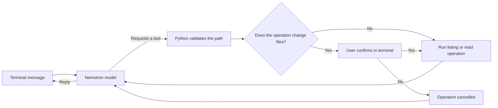

# 🤖 AI Terminal Assistant

A Python terminal chatbot that converses in natural language and helps manage files and folders. The model interprets your request and, when needed, asks the program to run a file operation—with your confirmation before any changes are made.

> A personal project exploring Python, language model integrations, and controlled local tools.

## ✨ Features

- Ongoing terminal conversation with context during each session.
- List folders and files.
- Read UTF-8 text files.
- Create folders and files, and edit existing file contents.
- Copy, move, and rename files and folders.
- Delete files and folders with explicit confirmation.
- Confirmation before every operation that changes files.
- Assistant responses highlighted in orange in the terminal.

## 🧰 Tech Stack

- **Python** — chatbot logic and file operations.
- **OpenAI Python SDK** — client for an API compatible with the OpenAI format.
- **NVIDIA NIM** — configured endpoint for the Nemotron model.
- **python-dotenv** — loads local settings from `.env`.
- **Docker Compose** — runs the chatbot in a container.

## 🗂️ Project Structure

```text
bot-python/
├── app/
│   ├── chatbot.py      # Chat loop, file tools, and confirmations
│   ├── arquivo.txt     # Auxiliary project file, if used
│   └── main.py         # Reserved entry point
├── compose.yaml        # Docker service configuration
├── Dockerfile          # Python image and dependencies
├── requirements.txt    # Project dependencies
└── README.md
```

## ⚙️ Requirements

- Docker and Docker Compose.
- A valid API key for the configured endpoint.

## 🚀 Setup and Run

1. Create a `.env` file in the project root with your endpoint settings:

   ```env
   URL=https://integrate.api.nvidia.com/v1
   API_KEY=your_api_key
   ```

   Replace `your_api_key` with a valid key. Do not publish this file or commit your API key to GitHub.

2. Start the chatbot:

   ```bash
   docker compose up --build
   ```

3. Enter a request in the terminal. Type `sair`, `exit`, or `quit` to end the session.

To recreate the container after changing the configuration or code:

```bash
docker compose up -d --force-recreate python
docker compose attach python
```

## 💬 Example Requests

```text
List the files in the current folder.
Read the file notes.txt.
Create a folder named drafts.
Create a file drafts/ideas.txt with a list of ideas.
Copy notes.txt to drafts/notes-copy.txt.
Rename notes.txt to old-file.txt.
Delete drafts/ideas.txt.
```

Before changing the folder contents, the program shows the operation and asks for confirmation in the terminal. Enter `s` or `sim` to continue; any other response cancels the operation.

## 🔒 Safety Boundaries

- The assistant can access only the `app/` folder, mounted in the container as `/app`.
- Absolute paths, paths outside this folder, and paths through symbolic links are rejected.
- Access to files named `.env` is blocked.
- Confirmation is requested in the terminal before local file changes.
- Deletion is permanent; check the target path carefully.
- File reading is intended for UTF-8 text, not images or binary documents.
- Conversation history stays in memory only while the process is running.
- The assistant accesses files when prompted; it does not continuously monitor the folder in the background.

## 🧠 How It Works



The model does not access the disk directly. It requests a tool; the Python program validates the path, asks for confirmation when needed, and performs the operation.